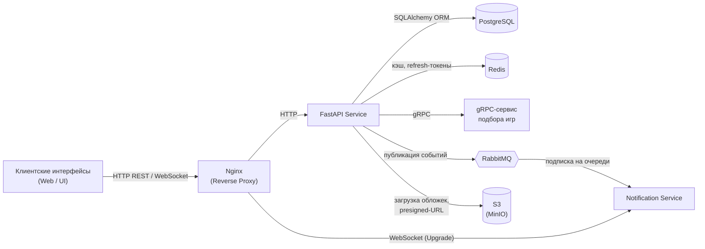
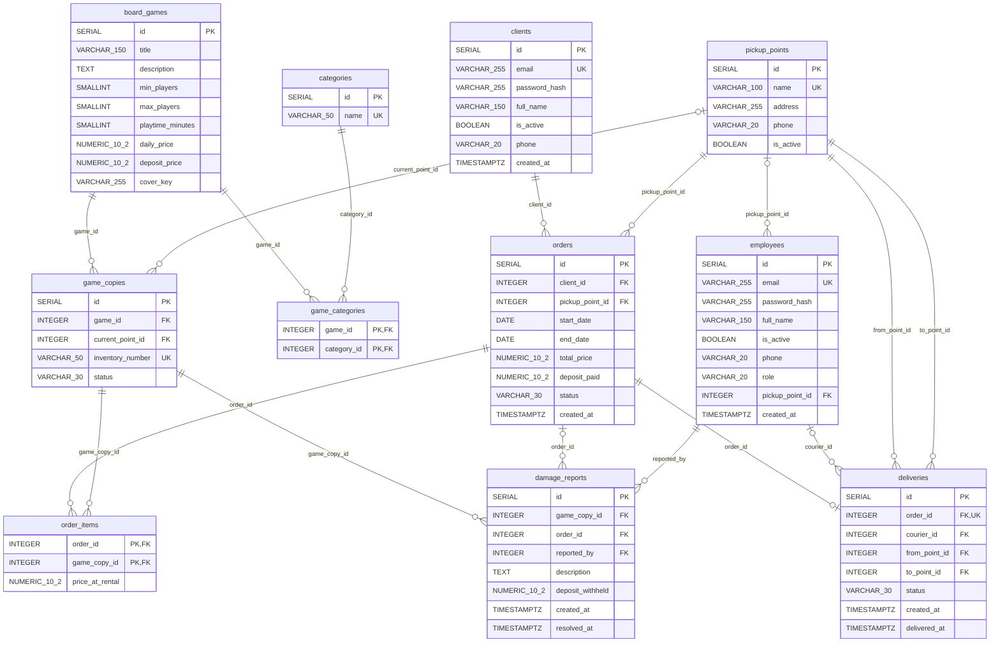

# 1 Предметная область и бизнес-цель приложения

## 1.1 Описание предметной области

Предметной областью проекта является сервис проката и резервирования настольных игр через сеть пунктов выдачи с распределённой службой доставки.

## 1.2 Бизнес-цель приложения

Создать распределённую систему бронирования и распределения настольных игр, которая сможет сократить время подбора игры под необходимые параметры и повысить оборот экземпляров настольных игр.

# 2 Функционал приложения и сценарии использования

## 2.1 Перечень функций по 4 ролям пользователей

### 2.1.1 Клиент

- регистрация и авторизация;
- поиск и просмотр каталога настольных игр с фильтрацией по категориям и пунктам выдачи;
- использование авто-подбора игр по параметрам встречи;
- оформление заказа на аренду;
- отслеживание статуса заказа в реальном времени, включая уведомления о готовности к выдаче.

### 2.1.2 Курьер

- авторизация в системе и подключение к каналу доставки задач;
- получение уведомлений о новых доставках и просмотр списка назначенных задач;
- смена статусов доставки в реальном времени.

### 2.1.3 Менеджер пункта выдачи

- просмотр списка заказов и наличия игр в закреплённом за ним пункте выдачи;
- приём игр от курьера и передача игр курьеру;
- передача игры клиенту;
- приём возвращённой игры от клиента: проверка комплектации и целостности, фиксация повреждений (если есть) и завершение аренды.

### 2.1.4 Администратор

- управление реестром настольных игр: создание новых записей об играх, редактирование описаний, тарифов, привязка категорий, загрузка обложек;
- ведение списка пунктов выдачи — адреса пунктов выдачи, их статус;
- управление учётными записями персонала: назначение ролей Менеджера и Курьера.

## 2.2 Сценарии использования

### 2.2.1 Клиент подбирает и бронирует настольную игру

1. Клиент заходит на сайт и входит в свой аккаунт.
2. Переходит в «Подбор игры», вводит параметры: 4 игрока, до 1.5 часов, заберёт в пункте «Центр».
3. Нажимает кнопку «Подобрать».
4. Система выдаёт список подходящих игр.
5. Клиент выбирает игру, нажимает «Забронировать», указывает даты бронирования и подтверждает.
6. На экране появляется номер заказа и текущий статус (например, «В пути в пункт выдачи», если игра едет из другого пункта выдачи).

### 2.2.2 Курьер перевозит игру между пунктами выдачи

1. Курьер открывает приложение.
2. У него на экране всплывает уведомление: «Новая доставка: забрать игру «Дюна» из пункта «Север» и отвезти в «Центр».
3. Курьер нажимает «Принять заказ».
4. Приезжает в пункт выдачи «Север», забирает коробку у менеджера и нажимает кнопку «Забрал, в пути».
5. Приезжает в «Центр», отдаёт коробку местному менеджеру и нажимает «Доставлено». Заказ пропадает из его активного списка.
6. Менеджер проверяет игру на целостность.

### 2.2.3 Менеджер выдаёт игру клиенту

1. Менеджер сидит в пункте выдачи, к нему подходит клиент и называет номер заказа.
2. Менеджер вбивает номер в поиск, видит статус «Готов к выдаче».
3. Берёт коробку с полки и отдаёт клиенту, нажимает в системе кнопку «Выдать».
4. Заказ переходит в статус «Активен», у клиента в телефоне статус меняется на «Игра выдана».

### 2.2.4 Администратор добавляет новую игру

1. Администратор заходит в раздел «Каталог игр» и нажимает «Добавить».
2. Заполняет поля: пишет название, описание, сколько человек может играть, среднее время, цену за сутки и выбирает категорию; при необходимости загружает обложку.
3. Нажимает «Сохранить».
4. Игра сразу отображается в общем каталоге у клиентов.

# 3 Архитектура приложения

Приложение строится как распределённая система из нескольких взаимодействующих сервисов:

1. **Клиентские интерфейсы (Web / UI).**
   - браузерные приложения для 4 ролей (Клиент, Курьер, Менеджер, Администратор);
   - общаются с бэкендом через HTTP REST-запросы и держат постоянное соединение по WebSocket для приёма уведомлений.
2. **Reverse Proxy (Nginx).**
   - единая точка входа для всего внешнего трафика;
   - принимает запросы от клиентов и проксирует их: обычные HTTP-запросы отправляет на FastAPI, а запросы с заголовком `Upgrade: websocket` перенаправляет напрямую на Notification Service.
3. **Основной бэкенд (FastAPI Service).**
   - реализует REST API для всего проекта (авторизация через JWT, CRUD каталога, оформление броней);
   - работает с базой данных через SQLAlchemy ORM;
   - интегрирован с Redis для быстрого кэширования;
   - выступает клиентом для gRPC-сервиса (запрашивает расчёты) и продюсером для RabbitMQ (публикует события об изменениях заказов);
   - напрямую работает с S3-хранилищем: принимает от администратора загружаемые обложки игр и выдаёт клиентам временные presigned-URL для их получения.
4. **Кэш данных (Redis).**
   - вспомогательное in-memory хранилище (ключ-значение):
     - так как каталог читается часто большим количеством пользователей, а изменяется редко, то можно не нагружать PostgreSQL частыми SQL-запросами с объединением таблиц, а кэшировать список игр в Redis на 5–10 минут;
     - кэшировать также нужно долгоживущие refresh-токены, добавляя механизм автоматического истечения срока (TTL).
5. **База данных (PostgreSQL).**
   - содержит пользователей, хэши паролей, реестр игр (включая S3-ключ обложки), категории, пункты выдачи, заказы и историю доставок.
6. **Сервис подбора игр (gRPC Service).**
   - отдельный сервис, куда вынесли вычисления, не относящиеся напрямую к CRUD-логике основного API:
     - принимает заданные клиентом параметры, ранжирует доступные игры каталога по степени соответствия и возвращает топ рекомендаций;
     - принимает состав заказа, длительность аренды, рассчитывает скидку за срок проката, итоговую стоимость и размер обязательного залога.
7. **Брокер сообщений (RabbitMQ).**
   - очередь для асинхронных событий, через которую FastAPI и сервис уведомлений не блокируют друг друга — бэкенд бросил событие и сразу вернул ответ клиенту, не дожидаясь доставки.
8. **Сервис уведомлений (Notification Service).**
   - подписан на очереди RabbitMQ и держит постоянные WebSocket-соединения с клиентами, курьерами и менеджерами;
   - получив событие из очереди, разбирает его и отправляет уведомление нужному пользователю.
9. **Объектное хранилище (S3).**
   - отдельный компонент распределённой системы, предназначенный для хранения обложек настольных игр; ключ объекта сохраняется в поле `cover_key` таблицы `board_games`;
   - FastAPI-сервис работает с S3 напрямую: загружает файлы, отправленные администратором, и выдаёт клиентам временные presigned-URL, по которым браузер получает изображение;
   - с Nginx, Notification Service, RabbitMQ, Redis и gRPC-сервисом S3 не взаимодействует;
   - в качестве реализации может использоваться MinIO как self-hosted S3-совместимое хранилище.
10. **Развёртывание (Docker).**
    - каждый компонент системы (Nginx, FastAPI, gRPC-сервис, Notification Service, PostgreSQL, Redis, RabbitMQ, S3 (например, MinIO)) запускается в отдельном Docker-контейнере.

Рисунок 1 – Схема взаимодействия компонентов распределённой системы (с S3-хранилищем обложек игр)

# 4 Структура базы данных

## 4.1 Логическая схема базы данных

В системе выделено 9 основных сущностей и 2 таблицы связей (`game_categories` и `order_items`):

1. Клиенты (`clients`) — физические лица, регистрирующиеся на платформе для бронирования и аренды настольных игр. Учётная запись не удаляется: флаг `is_active` отключает аутентификацию.
2. Сотрудники (`employees`) — персонал сервиса с разделением по должностям через поле `role` (COURIER, MANAGER, ADMIN). Для менеджеров указывается конкретный пункт выдачи (`pickup_point_id`), для остальных ролей он должен быть пустым. Как и у клиентов, флаг `is_active` отключает аутентификацию без удаления записи.
3. Пункты выдачи (`pickup_points`) — пункты выдачи по городу, где хранятся коробки и происходит выдача/приём игр.
4. Каталог настольных игр (`board_games`) — глобальный реестр моделей игр с их характеристиками (название, правила, игроки, суточный тариф, залог) и S3-ключом обложки (`cover_key`, необязательное поле).
5. Категории (`categories`) — список жанров настольных игр.
6. Физические коробки (`game_copies`) — конкретные материальные экземпляры игр с инвентарными номерами, либо привязанные к текущему пункту выдачи, либо находящиеся вне пунктов.
7. Заказы на аренду (`orders`) — заявки клиентов на прокат с указанием сроков, сумм и пункта получения.
8. Задачи на доставку (`deliveries`) — поручения курьерам на перемещение коробок между пунктами выдачи.
9. Акты повреждений (`damage_reports`) — записи о повреждениях и недостачах, выявленных менеджером при приёме коробки: описание, удержанная из залога сумма, время фиксации и устранения.

Таблицы связей:

- `game_categories` — связь M:N между `board_games` и `categories`; смоделирована как обычная `Table` без собственных атрибутов;
- `order_items` — связь M:N между `orders` и `game_copies`; в отличие от `game_categories`, смоделирована отдельным классом `OrderItem`, а не `Table`, потому что несёт собственное поле `price_at_rental` (тариф, зафиксированный на момент бронирования).

Таблицы `clients` и `employees` частично дублируют друг друга. Рассматривался вариант вынести общие поля в супертип `person` с подтипами-профилями или объединить всё в одну таблицу `user`. От обоих вариантов решено отказаться: клиент и сотрудник — разные категории доступа (публичная самостоятельная регистрация клиента и созданный администратором аккаунт сотрудника, разные правила аутентификации), поэтому раздельные таблицы лучше отражают предметную область, а цена в виде дублирования шести полей (`email`, `password_hash`, `full_name`, `is_active`, `phone`, `created_at`) несущественна.

Связи:

- `board_games` ↔ `categories` (M:N) — связь через таблицу `game_categories`;
- `orders` ↔ `game_copies` (M:N) — связь через таблицу `order_items` (в одном заказе может быть несколько игр, одна коробка сдаётся много раз);
- `board_games` → `game_copies` (1:N) — у одной модели игры может быть много физических коробок;
- `clients` → `orders` (1:N) — один клиент оформляет множество заказов;
- `orders` → `deliveries` (1:1) — для одного заказа формируется только одна доставка (уникальность `order_id`), которую выполняет один курьер;
- `orders` → `damage_reports` (1:N) — повреждение может быть выявлено при приёме игры по конкретному заказу;
- `employees` → `deliveries` (1:N) — один курьер выполняет множество доставок;
- `pickup_points` → `orders` (1:N) — в один пункт выдачи приходит множество заказов;
- `pickup_points` → `deliveries` (1:N) — пункт выступает и точкой отправления (`from_point_id`), и точкой назначения (`to_point_id`) разных доставок;
- `pickup_points` → `employees` (1:N) — к пункту выдачи привязаны менеджеры;
- `pickup_points` → `game_copies` (1:N) — в пункте выдачи числятся находящиеся там коробки;
- `game_copies` → `damage_reports` (1:N) — у одной коробки может быть несколько актов повреждений за время эксплуатации;
- `employees` → `damage_reports` (1:N) — один менеджер фиксирует множество актов.

Особенности реализации в ORM (SQLAlchemy):

- все внешние ключи, кроме двух каскадных, объявлены с `ondelete='RESTRICT'`: удаление записи, на которую есть ссылки, запрещено. Каскадное удаление (`ON DELETE CASCADE`) используется только в `game_categories.game_id`, `game_categories.category_id` и `order_items.order_id`;
- у relationship-ов, описывающих коллекции и обратные связи (`BoardGame.categories`, `Category.games`, `Order.items`, `Order.delivery`, `PickupPoint.employees`), указано `passive_deletes=True`: удаление зависимых строк делегируется базе данных, а не загружается в сессию;
- во всех relationship-ах задано `lazy="raise"`. Это архитектурное решение: неявная ленивая подгрузка связанных объектов запрещена, и любая попытка обратиться к незагруженной связи приводит к исключению. Нужные связи необходимо загружать явно (`selectinload`, `joinedload`) в запросе.

## 4.2 Физическая схема базы данных (PostgreSQL)

Рисунок 2 – Физическая ER-диаграмма базы данных

Все внешние ключи, кроме каскадных (`game_categories.game_id`, `game_categories.category_id`, `order_items.order_id`), создаются с `ON DELETE RESTRICT`.

Таблица 1 – `pickup_points` (пункты выдачи)

| Поле | Тип данных | Ограничения | Описание |
|---|---|---|---|
| id | SERIAL | PRIMARY KEY | Уникальный ID пункта |
| name | VARCHAR(100) | UNIQUE, NOT NULL | Название |
| address | VARCHAR(255) | NOT NULL | Физический адрес |
| phone | VARCHAR(20) | NOT NULL | Контактный телефон пункта выдачи |
| is_active | BOOLEAN | NOT NULL, DEFAULT TRUE | Работает ли пункт выдачи (при FALSE пункт скрыт из публичного списка, администраторам виден) |

Таблица 2 – `clients` (клиенты сервиса)

| Поле | Тип данных | Ограничения | Описание |
|---|---|---|---|
| id | SERIAL | PRIMARY KEY | Уникальный ID клиента |
| email | VARCHAR(255) | UNIQUE, NOT NULL | Почта (логин) |
| password_hash | VARCHAR(255) | NOT NULL | Хэш пароля (Argon2id) |
| full_name | VARCHAR(150) | NOT NULL | ФИО клиента |
| is_active | BOOLEAN | NOT NULL, DEFAULT TRUE | Признак активной учётной записи; при FALSE аутентификация отключена, строка не удаляется |
| phone | VARCHAR(20) | NOT NULL | Телефон для связи |
| created_at | TIMESTAMPTZ | NOT NULL, DEFAULT NOW() | Дата регистрации |

Таблица 3 – `employees` (сотрудники: курьеры, менеджеры, админы)

| Поле | Тип данных | Ограничения | Описание |
|---|---|---|---|
| id | SERIAL | PRIMARY KEY | Уникальный ID сотрудника |
| email | VARCHAR(255) | UNIQUE, NOT NULL | Рабочая почта (логин) |
| password_hash | VARCHAR(255) | NOT NULL | Хэш пароля (Argon2id) |
| full_name | VARCHAR(150) | NOT NULL | ФИО сотрудника |
| is_active | BOOLEAN | NOT NULL, DEFAULT TRUE | Признак активной учётной записи; при FALSE аутентификация отключена, строка не удаляется |
| phone | VARCHAR(20) | NOT NULL | Телефон сотрудника |
| role | VARCHAR(20) | NOT NULL, CHECK (role IN ('COURIER', 'MANAGER', 'ADMIN')) | Должность сотрудника |
| pickup_point_id | INTEGER | FOREIGN KEY → pickup_points(id) ON DELETE RESTRICT, NULL | Заполняется только для менеджеров пунктов выдачи |
| created_at | TIMESTAMPTZ | NOT NULL, DEFAULT NOW() | Дата создания аккаунта |
| Ограничение таблицы | — | CHECK ((role = 'MANAGER' AND pickup_point_id IS NOT NULL) OR (role <> 'MANAGER' AND pickup_point_id IS NULL)) | Пункт выдачи задан тогда и только тогда, когда роль — MANAGER |

Таблица 4 – `categories` (жанры игр)

| Поле | Тип данных | Ограничения | Описание |
|---|---|---|---|
| id | SERIAL | PRIMARY KEY | ID категории |
| name | VARCHAR(50) | UNIQUE, NOT NULL | Название категории |

Таблица 5 – `board_games` (каталог игр)

| Поле | Тип данных | Ограничения | Описание |
|---|---|---|---|
| id | SERIAL | PRIMARY KEY | ID модели игры |
| title | VARCHAR(150) | NOT NULL | Название |
| description | TEXT | NULL | Описание и краткие правила |
| min_players | SMALLINT | NOT NULL, CHECK (min_players > 0) | Минимум игроков |
| max_players | SMALLINT | NOT NULL, CHECK (max_players >= min_players) | Максимум игроков |
| playtime_minutes | SMALLINT | NOT NULL | Среднее время партии в минутах |
| daily_price | NUMERIC(10, 2) | NOT NULL, CHECK (daily_price >= 0) | Тариф за 1 сутки |
| deposit_price | NUMERIC(10, 2) | NOT NULL, CHECK (deposit_price >= 0) | Залог за коробку |
| cover_key | VARCHAR(255) | NULL | S3-ключ объекта с обложкой игры |

Таблица 6 – `game_categories` (связь M:N игры ↔ жанры)

| Поле | Тип данных | Ограничения | Описание |
|---|---|---|---|
| game_id | INTEGER | FOREIGN KEY → board_games(id) ON DELETE CASCADE | Ссылка на игру |
| category_id | INTEGER | FOREIGN KEY → categories(id) ON DELETE CASCADE | Ссылка на категорию |
| Первичный ключ | — | PRIMARY KEY (game_id, category_id) | Составной ключ |

Таблица 7 – `game_copies` (физические коробки в пунктах)

| Поле | Тип данных | Ограничения | Описание |
|---|---|---|---|
| id | SERIAL | PRIMARY KEY | ID конкретной коробки |
| game_id | INTEGER | FOREIGN KEY → board_games(id) ON DELETE RESTRICT, NOT NULL | Ссылка на модель игры |
| current_point_id | INTEGER | FOREIGN KEY → pickup_points(id) ON DELETE RESTRICT, NULL | Где коробка находится физически; NULL, если она у клиента или в пути |
| inventory_number | VARCHAR(50) | UNIQUE, NOT NULL | Инвентарный номер со штрихкода |
| status | VARCHAR(30) | NOT NULL, DEFAULT 'AVAILABLE', CHECK (status IN ('AVAILABLE', 'WITH_CLIENT', 'IN_TRANSIT', 'DAMAGED')) | Статус коробки |
| Ограничение таблицы | — | CHECK ((status IN ('WITH_CLIENT', 'IN_TRANSIT') AND current_point_id IS NULL) OR (status IN ('AVAILABLE', 'DAMAGED') AND current_point_id IS NOT NULL)) | Положение коробки согласовано со статусом |

Таблица 8 – `orders` (заказы клиентов)

| Поле | Тип данных | Ограничения | Описание |
|---|---|---|---|
| id | SERIAL | PRIMARY KEY | Номер бронирования |
| client_id | INTEGER | FOREIGN KEY → clients(id) ON DELETE RESTRICT, NOT NULL | Клиент сервиса, оформивший заказ |
| pickup_point_id | INTEGER | FOREIGN KEY → pickup_points(id) ON DELETE RESTRICT, NOT NULL | Где клиент хочет забрать игру |
| start_date | DATE | NOT NULL | Дата начала аренды |
| end_date | DATE | NOT NULL, CHECK (end_date >= start_date) | Дата завершения |
| total_price | NUMERIC(10, 2) | NOT NULL, CHECK (total_price >= 0) | Итоговая стоимость аренды |
| deposit_paid | NUMERIC(10, 2) | NOT NULL, CHECK (deposit_paid >= 0) | Сумма внесённого залога |
| status | VARCHAR(30) | NOT NULL, DEFAULT 'CREATED', CHECK (status IN ('CREATED', 'NEEDS_TRANSFER', 'IN_TRANSIT', 'READY_FOR_PICKUP', 'ACTIVE', 'COMPLETED', 'CANCELLED')) | Статус заказа |
| created_at | TIMESTAMPTZ | NOT NULL, DEFAULT NOW() | Время оформления |

Таблица 9 – `order_items` (связь M:N заказ ↔ коробки)

| Поле | Тип данных | Ограничения | Описание |
|---|---|---|---|
| order_id | INTEGER | FOREIGN KEY → orders(id) ON DELETE CASCADE | Ссылка на заказ |
| game_copy_id | INTEGER | FOREIGN KEY → game_copies(id) ON DELETE RESTRICT, NOT NULL | Ссылка на конкретную коробку |
| price_at_rental | NUMERIC(10, 2) | NOT NULL, CHECK (price_at_rental >= 0) | Фиксация тарифа на момент брони |
| Первичный ключ | — | PRIMARY KEY (order_id, game_copy_id) | Составной ключ |

Таблица 10 – `deliveries` (задачи курьера на трансфер)

| Поле | Тип данных | Ограничения | Описание |
|---|---|---|---|
| id | SERIAL | PRIMARY KEY | ID доставки |
| order_id | INTEGER | FOREIGN KEY → orders(id) ON DELETE RESTRICT, UNIQUE, NOT NULL | К какому заказу привязано (1:1) |
| courier_id | INTEGER | FOREIGN KEY → employees(id) ON DELETE RESTRICT, NULL | Сотрудник с ролью COURIER; NULL, пока доставку никто не принял (роль проверяется на уровне сервисного слоя) |
| from_point_id | INTEGER | FOREIGN KEY → pickup_points(id) ON DELETE RESTRICT, NOT NULL | Откуда везти |
| to_point_id | INTEGER | FOREIGN KEY → pickup_points(id) ON DELETE RESTRICT, NOT NULL | Куда доставить |
| status | VARCHAR(30) | NOT NULL, DEFAULT 'CREATED', CHECK (status IN ('CREATED', 'ACCEPTED', 'IN_TRANSIT', 'DELIVERED')) | Статус доставки |
| created_at | TIMESTAMPTZ | NOT NULL, DEFAULT NOW() | Время создания задачи |
| delivered_at | TIMESTAMPTZ | NULL | Время завершения |
| Ограничение таблицы | — | CHECK (to_point_id <> from_point_id) | Пункты отправления и назначения различны |

Таблица 11 – `damage_reports` (акты повреждений)

| Поле | Тип данных | Ограничения | Описание |
|---|---|---|---|
| id | SERIAL | PRIMARY KEY | ID акта |
| game_copy_id | INTEGER | FOREIGN KEY → game_copies(id) ON DELETE RESTRICT, NOT NULL | Какая коробка повреждена |
| order_id | INTEGER | FOREIGN KEY → orders(id) ON DELETE RESTRICT, NULL | В рамках какой аренды выявлено (NULL при плановой проверке) |
| reported_by | INTEGER | FOREIGN KEY → employees(id) ON DELETE RESTRICT, NOT NULL | Кто зафиксировал (менеджер) |
| description | TEXT | NOT NULL | Что повреждено или утеряно |
| deposit_withheld | NUMERIC(10, 2) | NOT NULL, DEFAULT 0, CHECK (deposit_withheld >= 0) | Сумма, удержанная из залога |
| created_at | TIMESTAMPTZ | NOT NULL, DEFAULT NOW() | Время фиксации |
| resolved_at | TIMESTAMPTZ | NULL | Когда коробка отремонтирована или списана |